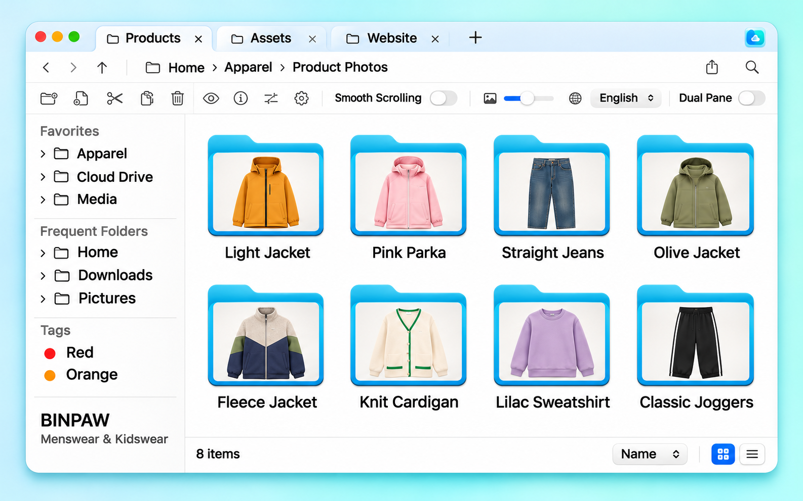

# Qingzhou Files · 轻舟文件

A native Mac file manager for visual workflows: folder covers, tabs, dual panes, image editing and screen recording in one app.

[中文介绍](README.zh-CN.md) · [Official website](https://binpaw.cn/en/) · [Download for Mac](https://github.com/52binpaw-sys/QingzhouFiles/releases/download/v0.10.15/qingzhou-files-0.10.15-apple-silicon-beta.dmg) · [Installation guide](https://binpaw.cn/en/install.html)

*Interface illustration simplified for presentation; see the website for an original software screenshot.*

## Features

- **Visual folder covers:** see images inside folders at a glance.
- **Tabs and dual panes:** keep folders ready and organize files side by side.
- **Preview and organization:** image zoom, favorites, tags and file operations.
- **Integrated image editing:** crop, resize, rotate, curves and color adjustments. Open multiple images in tabs and reuse crop dimensions.
- **Batch image export:** select images, set shared dimensions and JPG/PNG format, then export numbered filenames to a new folder. Uniform sizing uses proportional scaling and white padding.
- **Screen recording:** main-display or selected-region recording, pause/resume and a combined MP4 export.
- **Configurable shortcuts:** file management, image editing, screenshots and recording shortcuts in one settings page.

[GitHub releases](https://github.com/52binpaw-sys/QingzhouFiles/releases) · [Website download mirror](https://binpaw.cn/#release)

## Download and install

Current Mac beta: **0.10.15 (40)**. Requires **Apple Silicon (M-series) and macOS 13 or later**.

Download the DMG, save your work and quit any older version, then drag the app into Applications. This beta is not Apple Developer ID signed or notarized. Read the [installation guide](https://binpaw.cn/en/install.html) before first launch.

Screen recording requires macOS permission for **Qingzhou Files / 轻舟文件**; microphone audio requires microphone permission. The editor and recorder are integrated into the main app.

All features are free, with no purchase or activation required. Sidebar store and sponsored promotions help support development.

## Important notes

- Replacing an original image asks for confirmation and does **not** retain an original-file backup.
- Batch exports create a new folder and do not replace originals.
- Compilation, app signature integrity and installer checks passed for 0.10.15. The new recording workflow has not been manually tested; compatibility across Mac models and macOS releases remains incomplete.
- This repository is for product documentation and binary releases. Application source code is not included. Free availability does not mean the app is open source.

## Help and feedback

[User guide](https://binpaw.cn/en/guide.html) · [Release notes](https://binpaw.cn/en/changelog.html) · [Support the author](https://binpaw.cn/en/support.html)

Please describe your macOS version, app version, steps to reproduce and expected behavior when reporting an issue. Remove private filenames or account details from screenshots.
