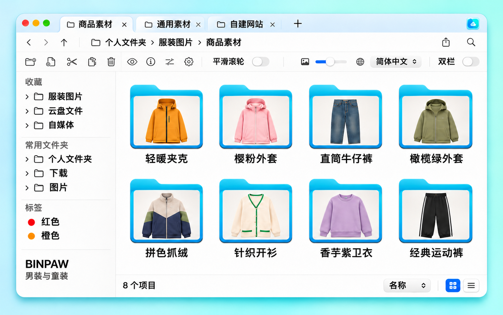

# 轻舟文件 · Qingzhou Files

面向素材工作流的 Mac 原生文件管理工具。文件夹封面、多标签、双栏、图片编辑与录屏，一个轻舟就够。

[English](README.md) · [轻舟官网](https://binpaw.cn/) · [下载 Mac 版](https://github.com/52binpaw-sys/QingzhouFiles/releases/download/v0.10.15/qingzhou-files-0.10.15-apple-silicon-beta.dmg) · [安装指南](https://binpaw.cn/install.html)

*界面展示图已为介绍精简，原始软件截图可在官网查看。*

## 主要功能

- **文件夹封面**：直接看到文件夹内的图片，快速辨认款式和项目。
- **多标签与双栏**：同时保留多个目录，方便对照整理。
- **预览与归档**：图片缩放预览、常用目录收藏、标签与文件操作。
- **内置图片编辑**：裁剪、尺寸、旋转、曲线与颜色调整；支持多图标签，沿用裁剪比例和尺寸。
- **按款批量出图**：选择图片，统一尺寸、JPG/PNG 格式和编号，导出到新文件夹；统一尺寸采用等比缩放、白色补边。
- **内置录屏**：主屏或区域录制，支持暂停/继续，停止后合并保存一个 MP4。
- **统一快捷键设置**：集中修改文件管理、修图、截图与录屏的快捷键。

[GitHub 版本发布](https://github.com/52binpaw-sys/QingzhouFiles/releases) · [官网下载备用入口](https://binpaw.cn/#release)

## 下载安装

当前 Mac 内测版：**0.10.15（40）**。需要 **M 系列 Mac 与 macOS 13 或以上**。

下载 DMG，将轻舟文件拖入 Applications。升级前先保存工作并退出旧版。当前未完成 Apple Developer ID 签名与公证，首次打开请按[安装指南](https://binpaw.cn/install.html)操作。

录屏权限授权给“轻舟文件”；录制麦克风时还需要麦克风权限。图片编辑与录屏已集成在主程序内，无需另外安装。

所有功能免费，无需购买或激活。侧栏店铺和推广内容支持维护。

## 使用前注意

- 覆盖原图前会要求确认，确认后不保留原图备份。
- 批量出图新建文件夹，不覆盖原图。
- 0.10.15 已完成编译、应用签名完整性与安装包校验；新增录制流程尚未实际录屏测试，其他机型和系统版本兼容性仍待验证。
- 本仓库仅发布软件介绍与安装包，不包含应用源码；免费使用不等于开源。

## 帮助与反馈

[使用方法](https://binpaw.cn/guide.html) · [更新记录](https://binpaw.cn/changelog.html) · [支持作者](https://binpaw.cn/support.html)

反馈问题时请提供系统版本、轻舟版本、复现步骤和预期结果。截图请遮挡私人文件名与账号信息。
